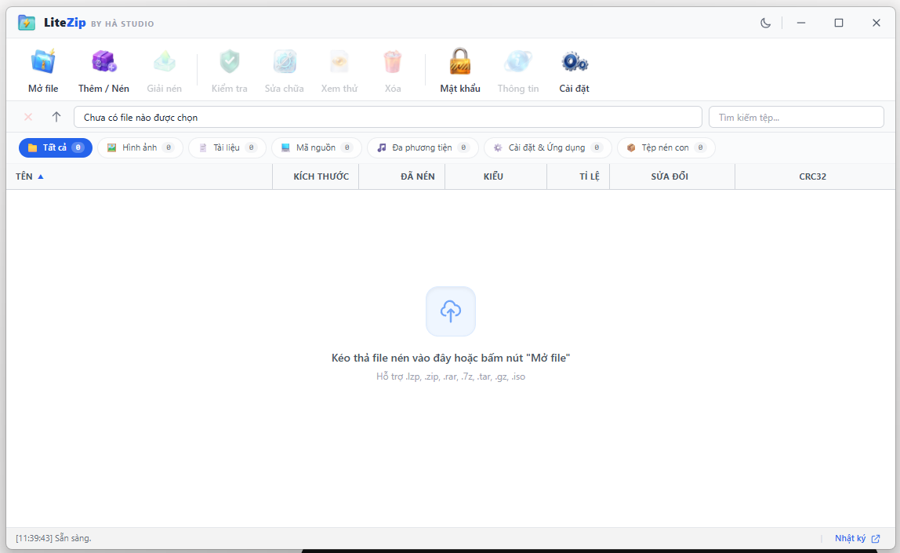
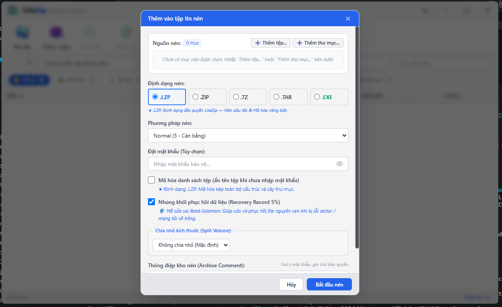
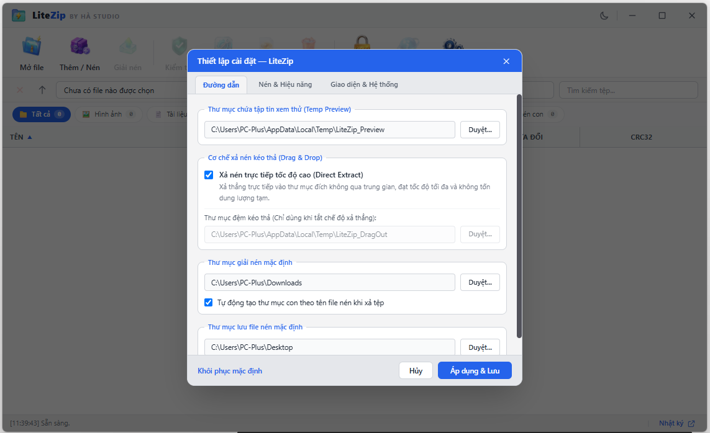
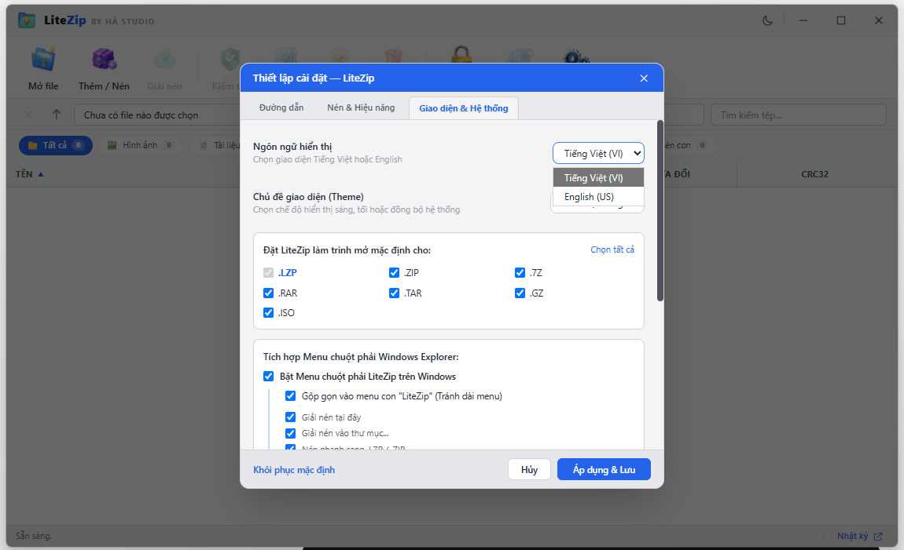

# 📦 LiteZip — Siêu Tốc & Đa Năng

**Công cụ quản lý nén & giải nén tệp tin thế hệ mới dành cho Windows — Phát triển bởi Hà Studio.**

---

## ✨ Giới thiệu

**LiteZip** được thiết kế để kết hợp hiệu năng nén mạnh mẽ, tốc độ giải nén đa luồng vượt trội và trải nghiệm giao diện trực quan chuẩn **Windows 11 Fluent Design** hỗ trợ cả chế độ Sáng và Tối[cite: 3, 5]. Phần mềm gọn nhẹ, sạch sẽ và không chứa quảng cáo.

---

## 📸 Ảnh chụp màn hình

### 1. Giao diện duyệt kho lưu trữ chính

_Giao diện quản lý tệp trực quan hỗ trợ Dark/Light Mode, hiển thị thông điệp kho nén (Archive Comment) và thông số chi tiết[cite: 3, 5]._

### 2. Hộp thoại tùy chọn nén thông minh

_Hỗ trợ tạo định dạng độc quyền `.lzp` (Zstandard), tùy chỉnh mức độ nén, đặt mật khẩu bảo vệ và nhúng ghi chú trực tiếp[cite: 3]._

### 3. Tùy chỉnh cấu hình & Liên kết hệ thống Windows

_Thiết lập linh hoạt thư mục giải nén mặc định, thư mục tạm và tối ưu hiệu năng đa luồng[cite: 3, 4]._

_Tích hợp sâu vào Menu chuột phải Windows Explorer và tự động gán biểu tượng nhận diện cho các định dạng tệp nén[cite: 3, 4]._

---

## 🚀 Tính năng nổi bật

- **Hỗ trợ đa định dạng phổ biến:** Đọc và giải nén mượt mà `.zip`, `.rar` (RAR4/RAR5), `.7z`, `.tar`, `.gz`, `.bz2`, `.xz`, `.iso`[cite: 3, 4].
- **Định dạng độc quyền `.lzp` (LiteZip Package):** Tích hợp thuật toán **Zstandard (Zstd)** kết hợp lớp bảo vệ cấu trúc riêng biệt, cho tốc độ nén và giải nén cực cao[cite: 3, 4].
- **Kéo thả thông minh (Drag & Drop):**
  - Kéo trực tiếp tệp tin từ cửa sổ LiteZip thả ra Desktop hoặc Windows Explorer chỉ với một thao tác giữ chuột[cite: 3, 4].
  - Hỗ trợ kéo thả nhiều tệp tin và thư mục cùng lúc giữ nguyên cấu trúc cây thư mục.
- **Menu chuột phải Windows Explorer 2 chiều:**
  - _Trên tệp nén:_ Mở với LiteZip, Giải nén tập tin..., Giải nén đến thư mục riêng, Giải nén Ở đây[cite: 3].
  - _Trên tệp/thư mục thường:_ Thêm vào tập tin nén... (tùy chỉnh mật khẩu, mức nén, ghi chú) hoặc nén nhanh 1 chạm[cite: 3].
- **Bảo mật & Tiện ích chuyên sâu:**
  - Hỗ trợ mã hóa mật khẩu mạnh và **mã hóa tiêu đề danh mục (Encrypt Header)** chống xem trộm danh sách tệp bên trong[cite: 3, 4].
  - Hiển thị **Thông điệp kho nén (Archive Comment)** trực quan ở cột bên phải kèm nút sao chép nhanh[cite: 3].
  - Tự động gắn biểu tượng nhận diện riêng cho các định dạng tệp nén trên Windows[cite: 3].

---

## 📥 Hướng dẫn tải về & Cài đặt

1. Truy cập mục **[Releases (Phát hành)](https://github.com/jangnguyen1st/LiteZip-Releases/releases/latest)** ở cột bên phải hoặc bấm vào nút tải màu xanh ở đầu trang.
2. Tại phiên bản mới nhất, tải về tệp cài đặt **`LiteZip_x.x.x_x64-setup.exe`**[cite: 3].
3. Mở tệp vừa tải và làm theo các bước trên trình cài đặt để tự động tích hợp vào Menu chuột phải và liên kết định dạng tệp Windows[cite: 3].

> **Yêu cầu hệ thống:** Windows 10 (64-bit) hoặc Windows 11 (64-bit).

---

## 📖 Hướng dẫn sử dụng nhanh

- **Mở kho lưu trữ:** Nhấp đúp trực tiếp vào tệp `.lzp`, `.zip`, `.rar`, `.7z`... ngoài Windows Explorer hoặc kéo thả tệp vào cửa sổ LiteZip[cite: 3, 4].
- **Giải nén nhanh:** Nhấp chuột phải vào tệp nén → chọn **LiteZip** → **Giải nén Ở đây** hoặc **Giải nén đến `<Tên_Thư_Mục>\`**[cite: 3].
- **Tạo tệp nén mới:** Nhấp chuột phải vào thư mục/tệp cần nén → chọn **LiteZip** → **Thêm vào tập tin nén...** để chọn định dạng (`.lzp`, `.zip`, `.7z`, `.tar`), đặt mật khẩu và thêm lời nhắn đính kèm[cite: 3, 4].

---

_© 2026 Hà Studio. Mọi quyền được bảo lưu._
